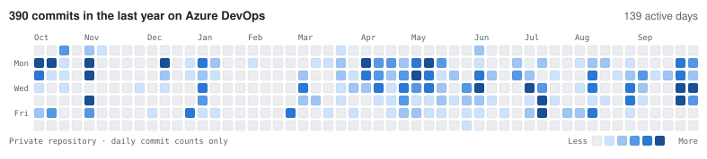

## My day to day work is on Azure DevOps. Here is my collaboration graph so far for 2026. We strictly work on a monthly sprints with very specific focus on what goes out the door.

<picture>
  <source media="(prefers-color-scheme: dark)" srcset="contrib-dark.svg">
  
</picture>

<!--
**ch3rr17/ch3rr17** is a ✨ _special_ ✨ repository because its `README.md` (this file) appears on your GitHub profile.

Here are some ideas to get you started:

- 🔭 I’m currently working on ...
- 🌱 I’m currently learning ...
- 👯 I’m looking to collaborate on ...
- 🤔 I’m looking for help with ...
- 💬 Ask me about ...
- 📫 How to reach me: ...
- 😄 Pronouns: ...
- ⚡ Fun fact: ...
-->
